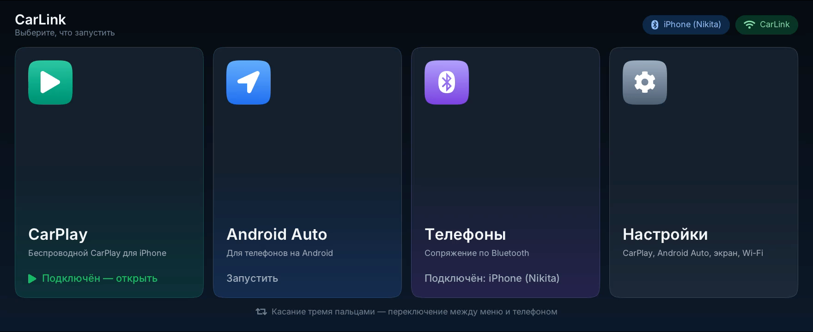
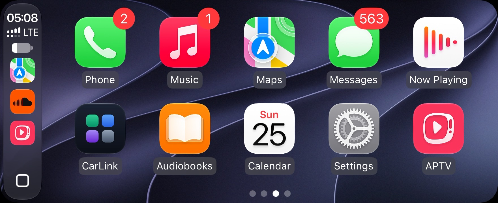
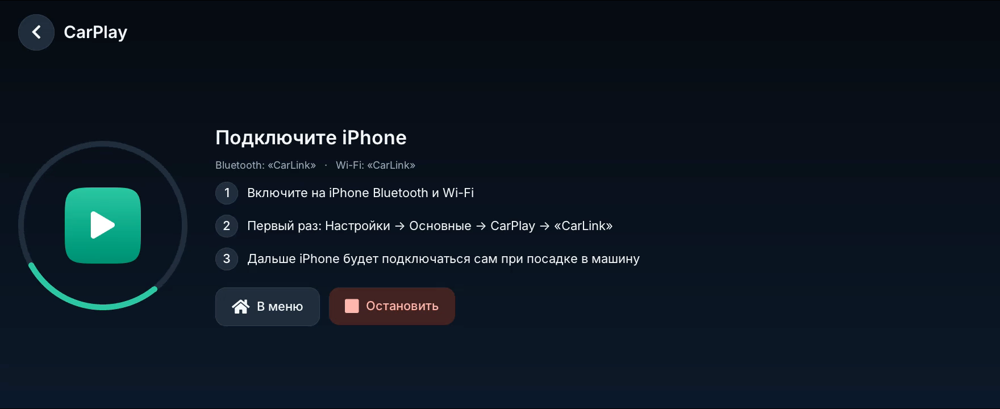
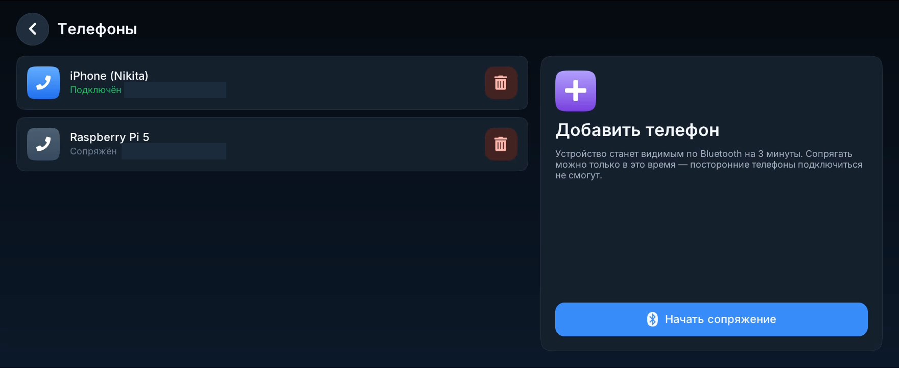
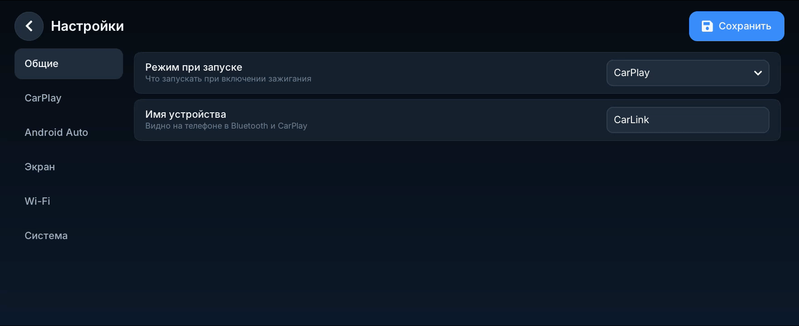

# QDPlay

Мост между потоковым видео и головным устройством (ГУ) автомобиля с приложением QDLink.
Плата подключается к USB магнитолы как Android-телефон (Android Open Accessory), а QDPlay отдаёт QDLink поток H.264 и принимает касания экрана.

На QDPlay построен **CarLink**: беспроводные CarPlay и Android Auto на штатной магнитоле с QDLink, с меню на экране ГУ.

> [!WARNING]
> Вы используете данное программное обеспечение на свой страх и риск. Авторы не несут ответственности за любой ущерб, причинённый этим ПО!

## Как это выглядит

Снимки экрана ГУ 1760×720 (Belgee X50), сняты через эмулятор QDLink на Mac с платой Radxa ZERO 3W по USB.

| | |
|---|---|
|  |  |
| Меню CarLink на ГУ | CarPlay. Иконка CarLink возвращает в меню |
|  |  |
| Ожидание подключения iPhone | Сопряжение телефонов по Bluetooth |
|  | |
| Настройки: режим при запуске, CarPlay, Android Auto, экран, Wi-Fi | |

## Что сделано

### QDPlay (эта ветка)

- **Несколько источников видео.** До 4 источников одновременно (меню, CarPlay, Android Auto). На ГУ уходят кадры активного источника, переключение не рвёт USB-сессию с ГУ. Новому источнику запрашивается ключевой кадр, а его кадры отбрасываются до SPS/IDR, чтобы на экране не оставалась старая картинка.
- **Надёжная USB-сессия.** Машина состояний USB accessory переписана по семантике `f_accessory`: START по uevent, сторожевой таймер прерывает зависший `read()`, чтения без потерь, при ошибках — повтор с паузой вместо `exit()`.
- **Протокол V2.** Сборка длинных сообщений из частей, расширенные заголовки, запрос ключевого кадра по `VIDEO_CTRL`, ответ на heartbeat в V1, безопасный разбор касаний и сообщений ГУ.
- **Приём видео.** Полные чтения, проверка размеров, исправления `accept()`.
- **Тесты.** Сессия через pty, фаззинг сообщений ГУ, переключение источников; сборка с AddressSanitizer/UBSan.

### Вокруг QDPlay

```
iPhone ──BT (iAP2)──▶ iap2
iPhone ──Wi-Fi (AirPlay)──▶ carplay ───────┐
Android ──BT + Wi-Fi──▶ aa-receiver ───────┼─H.264─▶ QDPlay ──USB AOA──▶ ГУ (QDLink)
                      carlink (меню) ──────┘          ◀── касания ──
```

Звук идёт с телефона на ГУ напрямую по Bluetooth: QDLink не передаёт звук по USB.

## Платы

- **Radxa ZERO 3W** (RK3566) — основная. Аппаратное кодирование H.264, Wi-Fi/Bluetooth AIC8800. Загрузка с малым током и «тихими» линиями USB до запуска гаджета: некоторые ГУ иначе снимают питание с порта. Перед первым запуском стереть загрузчик Radxa на eMMC, иначе стартует он, а не загрузчик с SD.
- **Orange Pi Zero 2W** (H618) — первая версия. Кодирование программное, встроенный Wi-Fi надёжно работает только на 2,4 ГГц.

На машине проверены CarPlay и Android Auto (Radxa ZERO 3W, Belgee X50).

## Поддерживаемые ГУ

Подходит любое ГУ с установленным QDLink. Разрешение экрана ГУ сообщает само, меню и CarPlay подстраиваются под него; Android Auto выбирает ближайшую ступень (800×480, 1280×720, 1920×1080) и закрывает разницу полями.

В старых релизах для Orange Pi разрешение было зашито в образ:
- `opi-zero-2w-сarplay-belgee-x50-new-hu-1760x720.img` — 1760×720 (Belgee X50 с ГУ на Android 9);
- `opi-zero-2w-сarplay-geely-old-hu-1920x590.img` — 1920×590 (Coolray и X50 на Android 4.3).

## MFI
Для работы CarPlay вам необходимо припаять чип `mfi337s3959` к шине `i2c` согласно [схеме](hardware/opi-zero-2w/orange-pi-zero-2w-mfi.pdf). Самый простой способ это сделать — заказать на производстве плату по данным [Gerber файлам](hardware/opi-zero-2w/orange-pi-zero-2w-mfi-gerber.zip) и собрать её.
Также доступна [3D модель](hardware/opi-zero-2w/case/) корпуса, готовая к печати на 3D принтере.

## Bluetooth
Встроенный `Bluetooth` у Orange Pi Zero 2W имеет дефект (телефон подключается только со второго раза), программный или аппаратный, поэтому на плате, упомянутой выше, добавлен дополнительный `USB` разъём для внешнего `Bluetooth` адаптера TP-LINK UB500.
Чтобы `USB` порт функционировал, `mfi` плату необходимо соединить шлейфом с `Orange Pi Zero 2W`. Шлейф нужен прямой, 25 контактов с шагом 0,5 мм.

Если вас устраивает дефект, то `USB` и его обвязку можно не припаивать.

## Подключение
1. Подключите плату к USB ГУ и запустите QDLink — на экране появится меню CarLink.
2. В меню **Телефоны** нажмите «Начать сопряжение» и подключите телефон по Bluetooth (окно сопряжения открыто 3 минуты).
3. **iPhone:** на телефоне Настройки → Основные → CarPlay → «CarLink». **Android:** запустите Android Auto из меню.
4. Подключите телефон к ГУ по Bluetooth и выберите его источником звука.

Дальше телефон подключается сам при посадке в машину. Режим при запуске, имя устройства и канал Wi-Fi настраиваются в меню **Настройки**. Касание экрана тремя пальцами переключает между меню и телефоном.

## Несколько источников видео

QDPlay принимает до 4 источников одновременно (например, меню [CarLink launcher](https://github.com/nikit6000/carlink-launcher) и CarPlay).
На ГУ уходят кадры только *активного* источника — последнего подключившегося. Когда он отключается,
экран возвращается предыдущему, при этом USB-сессия с ГУ не прерывается.
Касание экрана тремя пальцами (протокол V2) переключает источники.

Тач и запросы ключевого кадра отправляются только процессу активного источника (определяется по `SO_PEERCRED`).
Если у этого процесса нет подключения к сокету событий, они рассылаются всем — как раньше.

Дополнительные события сокета `/tmp/qdplay.messaging.socket` (числа big endian):

| event_id | направление | payload |
|---|---|---|
| 4 | QDPlay → клиент | `uint8 active, uint8 sources_count` — показывается ли сейчас этот процесс и сколько источников подключено |
| 5 | клиент → QDPlay | `uint8 command`: 1 — сделать меня активным, 2 — уступить экран предыдущему источнику |
| 6 | QDPlay → клиент | `uint16 width, uint16 height` — разрешение, которое сообщило ГУ |

Старые клиенты эти события просто пропускают.

## Тесты

```sh
cmake -DQDPLAY_BUILD_TESTS=ON -B build-test . && make -C build-test qdplay_test && ./build-test/qdplay_test
```

Тесты собираются с AddressSanitizer/UBSan и проверяют разбор сообщений ГУ (включая некорректные),
сборку длинных сообщений V2 и переключение источников видео.

# Для разработчиков
> [!WARNING]
> Крайне не рекомендуется выводить на ГУ, что-то кроме автомобильных ассистентов!

## Вывод видео
Для начала подключитесь к локальному сокету QDPlay:
```C
#include "qd_video_sender.h"
...
qd_screen_impl_ref screen = qd_screen_connect(video_width, video_height, frame_rate);
```

Тут:
  - `video_width` - Ширина видео потока;
  - `video_height` - Высота видео потока;
  - `frame_rate` - Частота кадров видео потока.

После подключения, на экране ГУ появится прогресс бар. Устройство готово к приему видео.
> [!IMPORTANT]
> Видео поток необходимо начинать отправлять сразу же после подключения!

Отправка видео потока:
```C
int ret = qd_screen_send_data(
    screen, // подключение к экрану
    (const uint8_t*)data, // h264 фрейм, начинающийся с 0x00 0x00 0x00 0x01
    (size_t)len // размер фрейма в байтах
);
```

Если нужно завершить трансляцию, то необходимо удалить сущность экрана и отключиться от сокета:
```C
qd_screen_close(screen);
```

Исходные коды данного вещателя можно найти [тут](video-sender).

## Получение событий

Для начала нужно присоединиться к сокету событий:
```C
int status = qd_input_reconnect();
```
> [!IMPORTANT]
> Переподключаться нужно до тех пор, пока `status` не станет равным нулю!

После успешного подключения вам нужно получать события при помощи вызова:
```C

static int _touch_screen_update(bool press, uint16_t x, uint16_t y) {
    // Обработка касания
    return 0;
}

static int _set_needs_key_frame(void) {
    // Запрос ключевого кадра у h264 провайдера
    return 0;
}

int main(int argc, char ** argv) {
    if (qd_input_reconnect() < 0){
        return -1;
    }

    while (1)
    {
        int result = qd_input_process(
            _touch_screen_update,
            _set_needs_key_frame
        );

        if (result == 0) {
            continue;
        }

        if (qd_input_reconnect() < 0) {
            break;
        }
    }

    return -1;
}
```
Исходные коды данного обработчика можно найти [тут](control-receiver).
